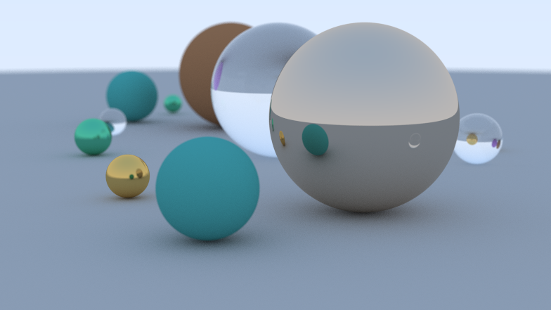

# Ray Tracer

A small C++17 path tracer that renders a scene of spheres and displays the image in a live OpenGL window. Rendering runs on a background thread and uses OpenMP to distribute scanlines across CPU cores.



## Features

- Diffuse, metallic, and dielectric materials
- Antialiasing through multiple samples per pixel
- Depth of field through a defocus lens
- Bounding volume hierarchy (BVH) acceleration
- OpenMP parallel rendering and an interactive GLFW/OpenGL viewport
- Escape key to close the viewport and stop rendering

## Requirements

- CMake 3.14 or newer
- A C++17 compiler
- OpenMP support
- Git (CMake fetches GLFW 3.3.8 on the first configure)
- A desktop environment with an OpenGL 3.3 capable driver

## Build and run

From the repository root:

```sh
cmake -S . -B build
cmake --build build --config Release
```

Run the executable from the build directory. The exact location depends on the generator and configuration. For example:

```sh
# Visual Studio (multi-configuration generator)
./build/Release/Renderer.exe

# Ninja or Unix Makefiles (single-configuration generator)
./build/Renderer
```

The first CMake configure downloads GLFW through `FetchContent`, so an internet connection is needed for the initial setup.

## Scene and render settings

The demo scene and camera settings are configured in `src/main.cpp`. Image width, samples per pixel, maximum ray depth, camera position, field of view, and defocus angle can be adjusted there. Increasing the image width or sample count improves image quality at the cost of render time.

## Controls

- **Esc**: close the viewport and request that the current render stop.